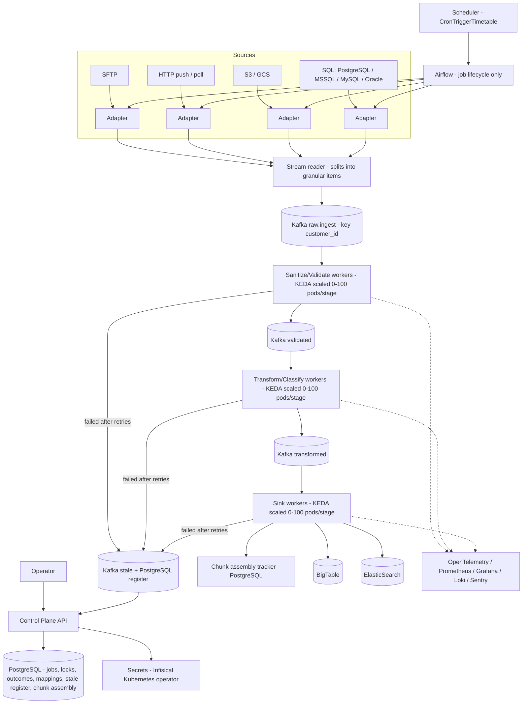
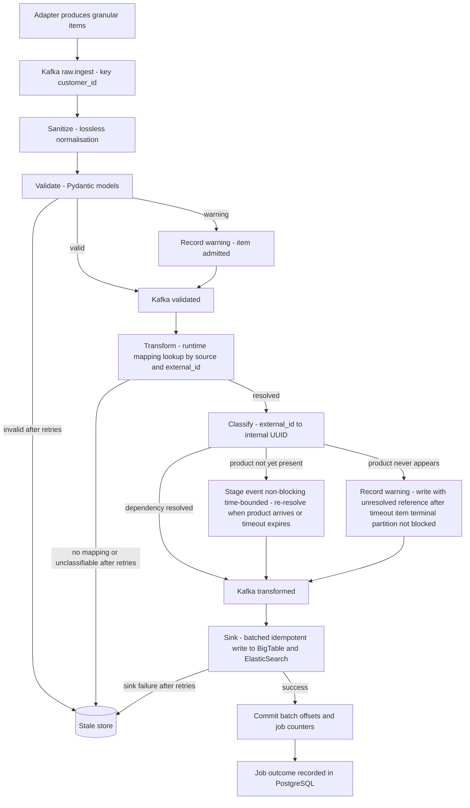
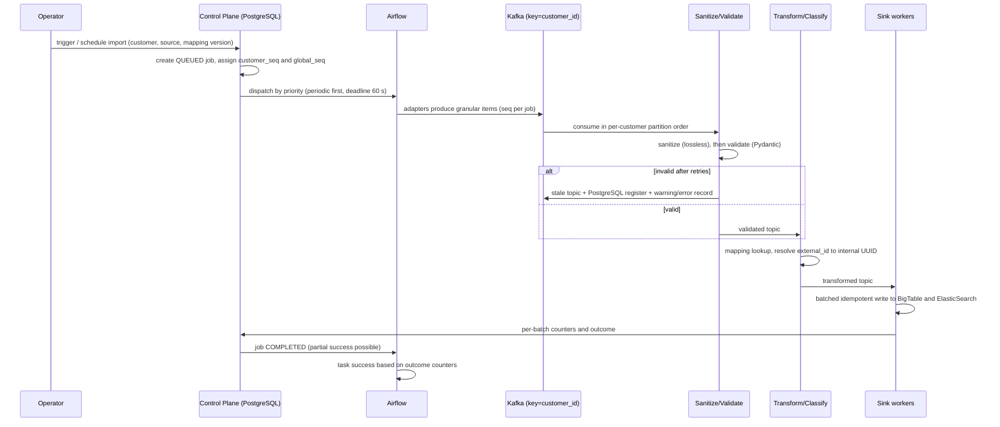

# Ingestion Pipeline — Clean Plan

This document describes the data pipeline ingestion workflow. The system ingests data from multiple sources through multiple protocols, sanitises and validates it, transforms it, maps it to the internal Customer, Event and Product classification, and writes it to BigTable and ElasticSearch. The Customer is the actor, the Event is an action caused by the Customer, and the Product is the object upon which the Event took place.

## 1. High-Level Context Diagrams

The context diagram shows the external sources, the pipeline components, the target storage, and the telemetry pipeline. The flow diagram shows the decision logic inside the pipeline. The sequence diagram shows the job lifecycle.

### 1.1 Context diagram (Mermaid, canonical format)

### 1.2 Flow diagram (Mermaid)

### 1.3 Sequence diagram (Mermaid)

### 1.4 How to visualise each format

| Format | Visualisation method | Notes |
| --- | --- | --- |
| Mermaid | Open `https://mermaid.live`, paste the block, export PNG/SVG. Render natively on GitHub and GitLab Markdown. In VS Code, install the Mermaid preview extension. From the command line, use `mmdc -i diagram.mmd -o diagram.png` from the `@mermaid-js/mermaid-cli` package. | This is the canonical format in this document. |
| PlantUML | Open `https://www.plantuml.com/plantuml/`, paste the code, download PNG/SVG. In VS Code, install the PlantUML extension. From the command line, run `java -jar plantuml.jar diagram.puml` or the `plantuml/plantuml` Docker image. | Use this format when C4, sequence, or deployment diagrams are required. |
| Graphviz DOT | Open `https://dreampuf.github.io/GraphvizOnline/`, paste the code, export SVG/PNG. In VS Code, install the Graphviz preview extension. From the command line, run `dot -Tpng diagram.dot -o diagram.png`. | Use this format for dependency and call graphs. |
| D2 | Open `https://play.d2lang.com/`, paste the code, export PNG/SVG. In VS Code, install the D2 extension. From the command line, run `d2 diagram.d2 diagram.png` with the binary from `https://d2lang.com/`. | Use this format when a polished presentation image is required. The D2 implementation is open source under the Apache License 2.0. |

All four formats describe the same system. The Mermaid format is the source of truth, and the other formats are equivalent renderings of it.

## 2. Technology, Tools, and Principles

### 2.1 Principles

- The system processes every granular item through sanitisation, validation, transformation, classification, and ingestion, and it records the outcome of every item.
- The import continues on a best-effort basis when an item fails validation or transformation. The failing item is quarantined, a warning or error record is issued, and the remaining items continue.
- Workers are stateless. All durable state resides in PostgreSQL for coordination and in Kafka for the message log, so any worker can be terminated and replaced without data loss.
- Delivery is at-least-once, and every sink write is idempotent. Sinks use deterministic keys based on the internal UUID and the external identifier, so retried batches converge to the same record instead of creating duplicates.
- Only one import job is in RUNNING state per customer at a given time. PostgreSQL enforces this with a partial unique index on active jobs per customer (active = RUNNING + PAUSED; a PAUSED job retains its reservation except during a preemption handoff, where the lock transfers to the preempting periodic job until it finishes), and the dispatcher claims jobs with row locks so that concurrent dispatchers cannot claim the same job.
- Kafka partitions items by `customer_id`, which provides per-customer first-in-first-out ordering of granular items *within one running job*. The `external_id` is the identity and deduplication key in the tuple `(source_system, entity_type, external_id)`, and it is not used as the partition key or as the locking key. Across jobs of the same customer, FIFO is not guaranteed when preemption occurs: a periodic job may complete before an earlier paused one-time job, and out-of-order completion is resolved by last-write-wins (source timestamp / sequence version).
- Job priority is more important than global first-in-first-out order. Periodic jobs are dispatched before one-time jobs. A periodic job has a 60-second start SLO (scheduled minute in UTC to worker-ready time, warning at 30 s / critical at 60 s), not an absolute guarantee: if all 100 running *job* slots are occupied by non-pausable periodic jobs, the SLO cannot be met and the deviation is recorded and alerted. "100 slots" means 100 concurrently admitted jobs (dispatcher counter in PostgreSQL); this is distinct from worker pods, which scale to 100 per stage (see below). If a slot is free, the periodic job starts immediately; otherwise the dispatcher cooperatively pauses the lowest-priority running one-time job at its next batch checkpoint and releases the slot. Priority-first ordering has no fairness bound: under continuous periodic load, one-time jobs may be delayed indefinitely, which is a capacity-planning signal.
- Kafka offsets are committed per batch, after every item in the batch reaches a terminal state. Offsets are never held for the duration of a whole job, because that would block the customer partition behind a single failing item and would violate the best-effort requirement.
- Large source data is split by the input producer into granular items before publication. Each granular item carries a parent identifier, a chunk index, a chunk count, a byte range, a total size, and a checksum. The sink layer assembles chunks by parent identifier when all chunks are present.
- Worker pods (Sanitize/Validate, Transform/Classify, Sink stages) scale to zero when idle and scale up to 100 pods per stage when work arrives, each stage scaling independently based on its own Kafka consumer lag (up to 300 pods total across the three stages). The control plane, the Airflow scheduler, PostgreSQL, and Kafka run with fixed minimal replicas and do not scale to zero; "scale to zero" means worker stages only. Cold-start time counts toward the 60-second SLO unless a warm pool is configured for the periodic path.
- Airflow manages job lifecycles only. Airflow learns job success from the aggregated outcome counters in PostgreSQL through the Control Plane API. Airflow does not receive per-item results, and the Airflow result backend stores task state only. Operator semantics: pause stops adapter production, workers finish the current batch then checkpoint (offsets committed, watermark saved), job moves to PAUSED and its slot is released; resume continues from the committed offset/watermark in priority order; cancel stops production, in-flight items finish the current batch to a terminal state (sink or stale), already-written sink data is not rolled back (no compensation), and the job moves to CANCELLED with an outcome record noting partial results.
- Secrets are injected at pod start by the Infisical Kubernetes operator. Only secret references are stored in PostgreSQL and Kafka, and secret values never appear in messages, logs, traces, or database fields.
- Mapping definitions are versioned, stored in source control, loaded into PostgreSQL at runtime, and pinned per job. Updating a mapping and replaying stale items is the primary remediation path.

### 2.2 Technology and tool selection

| Layer | Selected technology | Purpose |
| --- | --- | --- |
| Orchestration | Apache Airflow 2.9 or newer | Schedules periodic and one-time jobs, supervises job lifecycles, and exposes pause and cancel operations. |
| Message broker | Apache Kafka, or the Kafka-compatible Redpanda | Provides durable partitioned logs, per-customer ordering by partition key, replay, and the stale topic. |
| Control plane | FastAPI with PostgreSQL | Provides the operator API, the job state machine, per-customer locking, the priority dispatcher, outcome records, and the stale-item register. |
| State store | PostgreSQL | Stores job state, per-customer sequence numbers, global sequence numbers, outcome counters, the mapping registry, the stale register, and the chunk assembly tracker. |
| Worker runtime | Python 3.12 with asynchronous input and output | Implements the three stateless worker stages with high concurrency per pod. |
| Validation | Pydantic version 2 | Defines strict typed models for Customer, Event, and Product, and produces typed validation errors. |
| SFTP client | Paramiko | Reads files from SFTP sources with streaming reads. |
| HTTP client | HTTPX | Handles webhook ingestion and HTTP polling with streaming responses. |
| Object storage clients | Botocore for S3, `google-cloud-storage` for GCS | Reads buckets and writes the raw landing zone for large payloads. |
| SQL source access | SQLAlchemy 2.0 with `psycopg`, `pymssql`, `pymysql`, and `oracledb` | Reads PostgreSQL, MSSQL, MySQL, and Oracle sources with server-side cursors, read-only credentials, and incremental watermarks. |
| BigTable sink | `google-cloud-bigtable` | Writes wide-column rows with batched mutations and deterministic row keys. |
| ElasticSearch sink | ElasticSearch Python client 8.x | Writes search documents with bulk requests and deterministic document identifiers. |
| Secrets | Infisical Kubernetes operator, with the External Secrets Operator as an alternative | Injects credentials into pods at start time and supports rotation without code changes. |
| Autoscaling | Kubernetes Event-driven Autoscaling (KEDA) | Scales each worker stage from 0 to 100 replicas based on Kafka consumer lag. |
| Observability | OpenTelemetry, Prometheus, Grafana, Loki, and Sentry | Collects traces, metrics, logs, error reports, and production profiling. |

## 3. Telemetry Data and Metrics

The system exposes metrics, traces, logs, profiling data, and per-job outcome records. All signals share the identifiers `trace_id`, `job_id`, `customer_id`, and `external_id`, so a single item can be followed across adapters, workers, and sinks.

### 3.1 Metrics exposed for monitoring

| Metric | Type | Meaning and use |
| --- | --- | --- |
| `pipeline_items_total{stage, status}` | Counter | Counts items per stage and outcome. This is the primary throughput and quality signal. |
| `items_per_second` | Gauge over a rolling window | Measures end-to-end throughput in granular items per second (items committed to both sinks, rolling 1-minute window). This is the acceptance target for 10,000 items per second with 100 worker pods per stage (100 items/s/pod/stage); it is a load-test target, not a guarantee until the soak gate passes. |
| `job_duration_seconds{customer_id, source_system}` | Histogram | Measures job duration and identifies slow customers or sources. |
| `job_outcome_total{status}` | Counter | Counts jobs by terminal state. |
| `job_items_total{job_id, outcome}` | Counter | Records received, validated, transformed, written per sink, warnings, and stale items per job. This is the evaluable result of a run. |
| `consumer_lag{topic, partition}` | Gauge | Measures unconsumed messages per partition. Growing lag is the primary capacity alert. |
| `queue_depth{job_status}` | Gauge | Measures queued, running, and paused jobs. This verifies the 100-job admission limit and the priority-ordered queue (Section 2.1, not global FIFO). |
| `schedule_deviation_seconds` | Gauge and histogram | Measures the deviation between scheduled and actual job start. A warning alert fires at 30 seconds and a critical alert fires at 60 seconds. |
| `preemptions_total` | Counter | Counts periodic jobs that paused a one-time job to meet the deadline. This is the capacity-planning signal. |
| `dlq_total{stage, reason_code}` | Counter | Counts items moved to the stale store per stage and reason. A spike indicates a data-quality or mapping problem. |
| `warnings_total{stage, reason_code}` | Counter | Counts warnings issued for admitted items per stage and reason. |
| `retries_total{stage}` | Counter | Measures retry pressure per stage. A rising trend indicates an unstable sink or source. |
| `sink_write_latency_seconds{sink}` | Histogram, p50/p95/p99 | Measures BigTable and ElasticSearch write latency. |
| `sink_errors_total{sink}` | Counter | Counts sink write failures per sink. |
| `worker_replicas{stage}` | Gauge | Measures the replica count per worker stage. This verifies scale-to-zero (worker stages only) and the 100-pods-per-stage ceiling. |
| `worker_utilization{stage}` | Gauge | Measures utilisation during active periods. |
| `mapping_lookup_latency_seconds` | Histogram | Measures mapping registry lookup latency in the Transform stage. |
| `transform_failures_total{reason_code}` | Counter | Counts transformation failures per reason. |
| `chunk_assembly_pending` | Gauge | Counts parent items that are awaiting remaining chunks. |
| `job_rejected_total{reason}` | Counter | Counts permanently rejected job submissions per reason. Rejected jobs remain as auditable records. |

### 3.2 Traces

- The system uses OpenTelemetry distributed tracing with tail-based sampling. Errors and stale decisions are sampled at 100 percent, and normal traffic is sampled at 1 to 5 percent.
- The system creates one span per job and one span per batch. Individual items are represented by log events, because per-item spans at 10,000 items per second would generate unmanageable trace volume.
- The system propagates `trace_id` and `job_id` in every Kafka envelope, so one trace follows an item across all stages.

### 3.3 Logs

- The system emits structured JSON logs through the OpenTelemetry Collector or Grafana Alloy to Loki. Loki is the recommended backend because it is purpose-built for log volume.
- If the Elastic Common Schema log stack is required, logs are written to a separate ElasticSearch cluster with index lifecycle management. Logs are never mixed with pipeline data in the same ElasticSearch cluster, because that contention would endanger the throughput target.
- Every log event contains the timestamp, the log level, `trace_id`, `job_id`, `customer_id`, `source_system`, `external_id`, `entity_type`, `stage`, `outcome`, and `reason_code`.
- Logs never contain payloads, credentials, or personal data.

### 3.4 Profiling

- The system uses Sentry continuous profiling in production to diagnose CPU hotspots, and ad-hoc `py-spy` profiling during incidents.
- Profiling informs optimisation only. Profiling does not measure throughput and is not an acceptance criterion.

### 3.5 Job outcome records

- The system writes one outcome record per job in PostgreSQL. The record contains the received count, the sanitised count, the validated count, the transformed count, the written count per sink, the warning count, the stale count, and the duration.
- The outcome record is queryable through the operator API and is decomposable in Grafana by customer, source, entity type, and mapping version.

### 3.6 Alerts

- The system raises an alert when consumer lag grows monotonically.
- The system raises a warning alert at 30 seconds of schedule deviation and a critical alert above 60 seconds.
- The system raises an alert when the stale rate or the warning rate exceeds its configured threshold.
- The system raises an alert when a worker stage reaches 100 pods while consumer lag remains.
- The system raises an alert when a sink error budget is exhausted.
